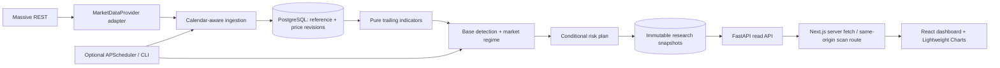

# Architecture

The backend separates I/O, persistence, calculations and strategy decisions. `providers/base.py` is the extension protocol; Massive implements only the daily-data features Phase 1 needs. Future snapshot, minute, news and financial-statement capabilities should be explicit separate protocols rather than silently returning unavailable data.

`indicators.py`, `screener.py` and `risk.py` are independent of HTTP/database state. Ingestion owns validation, session completeness and append-only corrections. `services/research.py` reads a consistent provider/adjustment stream, rejects missing sessions, aligns QQQ observations and writes the evidence and parameter hash used for each setup. HTTP mutation handlers commit atomically; read endpoints never start scans. The whole-universe CLI uses per-symbol transactions so a long provider job is restartable.

The Next.js server communicates with the API through `API_BASE_URL`. No key is sent to the browser. Browser chart code only receives bars and research plans. Dashboard scans use a same-origin POST proxy. CORS is limited to configured origins. Local-only port bindings are intentional; authentication and a job queue must precede public/multi-user deployment.

Phase 1 uses PostgreSQL for deployment, SQLite for convenient local testing, and one optional APScheduler worker. No Redis dependency is needed for correctness. Introduce Redis cache keys containing universe, provider, adjustment mode, version and as-of timestamp if profiling justifies it; never cache mutable “latest” values as historical truth. Move large ingest/scan jobs to a dedicated worker in Phase 2.

## Time and provenance

Sessions are XNYS regular trading days; close times come from `exchange_calendars`, including DST, holidays and early closes. Stored datetimes are UTC. Naive datetimes returned by SQLite are interpreted as UTC only at the storage boundary; API inputs must be timezone-aware. Calculation functions receive ordered completed bars; the ingestion/service boundary enforces the calendar and availability cutoffs.

Every ingested price has provider, adjustment flag, first observation timestamp, ingestion timestamp and an availability basis. Identical reingestion is a no-op; changed data creates a revision. Each indicator snapshot retains source price IDs, QQQ price IDs, universe symbols, regime evidence, formula version and full settings. This preserves what was calculated; it does not establish the historical truth of a modern backfill. Stock reference rows are current metadata; historical membership/classification needs its own versioned provider source before backtesting.

The API currently scans a single process/database view, not a distributed snapshot across concurrent ingestion jobs. Run ingestion and scanning serially (the default CLI and scheduler do this). Before concurrent production jobs, add explicit ingestion-batch IDs and repeatable-read scan transactions.

## Future integrations

- SEC EDGAR: optional backend adapter with a required descriptive `SEC_USER_AGENT`, CIK mapping, SEC-compatible rate limiting, original accession IDs, filing/publication/observation timestamps and amendment history. Plan destinations `data.sec.gov` and `www.sec.gov` when this feature is implemented; no SEC calls or credentials are required now.
- Phase 2: market snapshots, regular-session minute data, cumulative same-time volume baselines, opening range confirmation and timestamped human catalyst verification. Webhooks/alerts need deduplication and no broker orders.
- Phase 3: independent chronological event engine, historical universe and data vintages, corporate-action handling, execution costs, ambiguity policy, out-of-sample runs and journal UI. It must not reinterpret a daily-close signal as an earlier executable fill.
- Phase 4: calibrated statistical models and optional paper-only broker adapter. Live automated trading is outside the initial scope.
