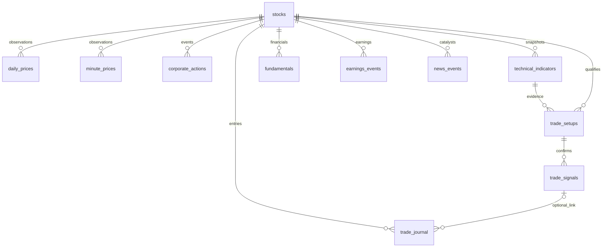

# Database schema

The first Alembic migration explicitly creates the schema; later model edits require a new migration. SQLAlchemy types map to PostgreSQL `TIMESTAMP WITH TIME ZONE`, JSON, DATE, DOUBLE PRECISION, VARCHAR/TEXT, INTEGER and BOOLEAN. Prices use finite float64 for analytics; risk sizing converts inputs through decimal strings and floors integer shares. An eventual broker ledger should use fixed-precision monetary types and explicit tick-size rounding.

Every table has an integer primary key `id`. All `stock_id`, `indicator_id`, `setup_id` and `signal_id` columns reference their respective parent tables. Deletes do not silently cascade through research history. Symbol, lookup foreign keys and as-of/session access paths are indexed.

| Table | Main columns | Integrity and temporal behavior |
| --- | --- | --- |
| stocks | symbol, name, security_type, active, exchange, sector?, industry?, provider, reference_as_of | Unique symbol. Current reference metadata; ETFs stored but excluded from common-stock rankings. Unknown classification stays null. |
| daily_prices | stock_id, session, open/high/low/close, volume, provider, adjusted, available_at, ingested_at, availability_basis | Unique stock/session/provider/adjusted/available_at. Composite stock/session/availability index. Positive prices, valid OHLC envelope and nonnegative volume. Corrected bars append revisions. |
| minute_prices | stock_id, timestamp, OHLCV, provider, adjusted, available_at | Unique stock/timestamp/provider/adjusted/available_at; Phase 2 ingestion. |
| corporate_actions | stock_id, event_key, kind, effective_date, provider, available_at, payload | Unique stock/provider/event_key/available_at. Future split/dividend data vintages. |
| technical_indicators | stock_id, as_of, session, version, parameters_hash, values, provenance | Unique stock/as_of/version/parameters_hash. Immutable calculated observations; full price input IDs and universe/regime/settings evidence in JSON. |
| fundamentals | stock_id, period_end, available_at, provider, values | Unique stock/period_end/available_at/provider. Publication/observation cutoffs required for future use. |
| earnings_events | stock_id, event_at, available_at, provider, values | Unique stock/event_at/available_at/provider. Actual announcement time is distinct from fiscal period. |
| news_events | stock_id, published_at, available_at, title, url, provider, catalyst_verified, verified_at?, verified_by? | Unique stock/url/available_at. Default unverified; future verification must be timestamped and authenticated. |
| trade_setups | stock_id, indicator_id, as_of, strategy, status, parameters_hash, plan, explanation | Unique stock/as_of/strategy/parameters_hash; status/as-of indexes. One observation per scan configuration. |
| trade_signals | setup_id, observed_at, kind, evidence | Unique setup/observed_at/kind. Only price-and-volume confirmed daily setups create a signal. Signal is explicitly not a fill. |
| backtest_results | created_at, strategy, parameters, data_manifest, metrics, trades | Reserved for Phase 3. Manifest must identify data vintages, universe, costs, ordering policy and split definitions. |
| trade_journal | stock_id, signal_id?, entered_at, exited_at?, shares, entry_price, exit_price?, notes | Shares must be positive. Reserved for Phase 3; no write API yet. |

JSON snapshots allow versioned formula outputs without adding a column for every indicator. Persisted `parameters_hash` is SHA-256 of canonical JSON settings, and `version` identifies the formula implementation. A rerun with the same stock/as-of/settings reuses the observation; changed settings produce another observation. The dashboard chooses the most recent saved scan, while stock detail exposes the selected snapshot's timestamp separately from its price-bar range.

Historical reference classifications, raw intraday provenance expansion, fixed-precision execution accounting, and stricter event-specific constraints are prerequisites for later phases. Reserved tables are schema preparation, not evidence that their ingestion or trading workflows exist.
